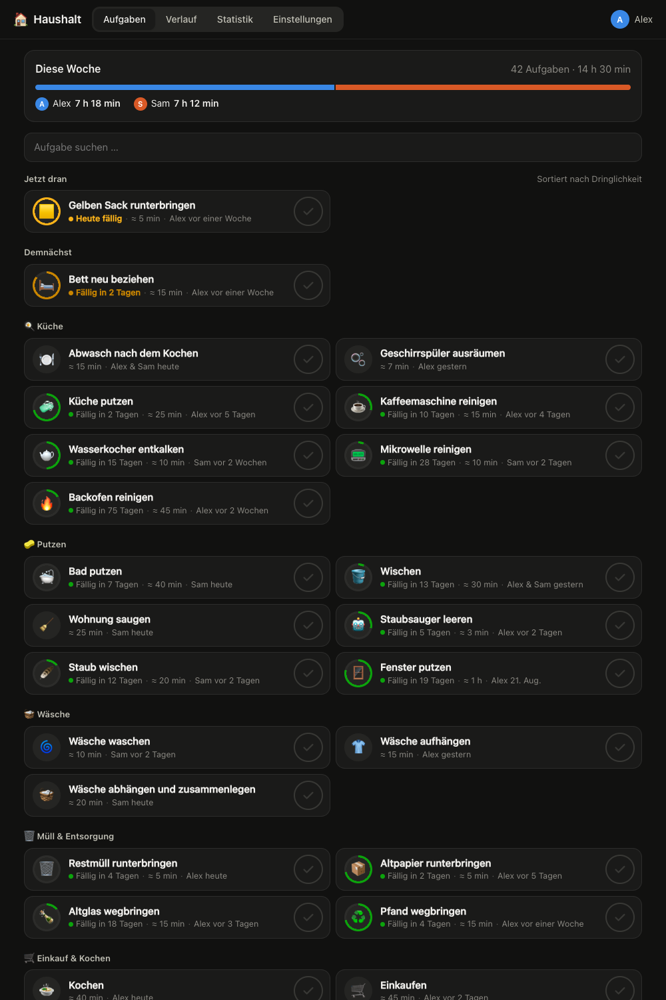
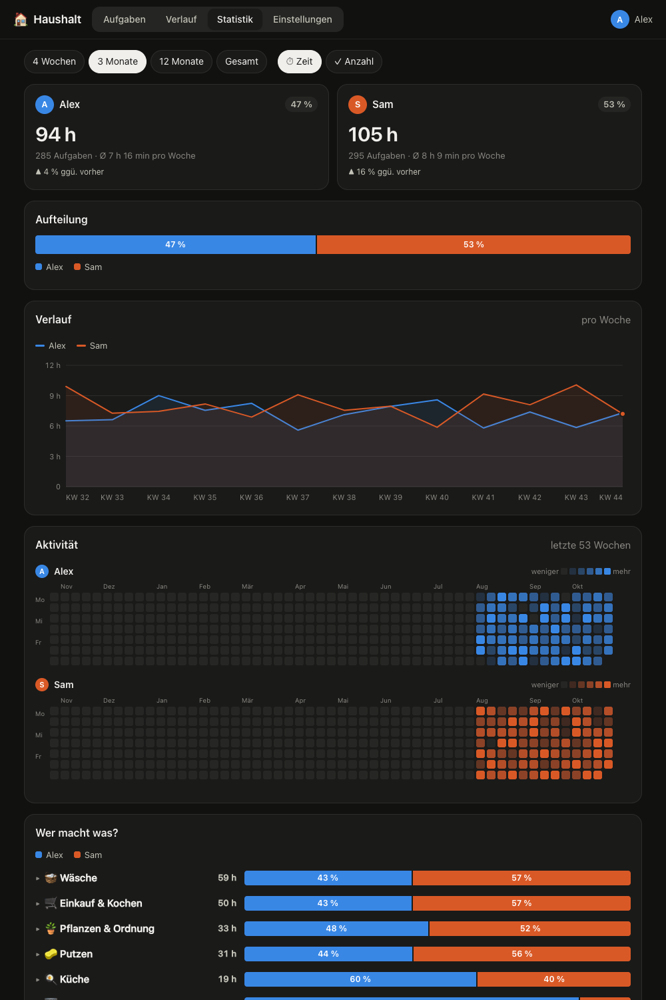

# Haushalt – Home-Assistant-App für Hausarbeit

Wer hat zuletzt das Bad geputzt? Wer bringt eigentlich immer den Müll runter? **Haushalt** ist eine App (Add-on) für Home Assistant, mit der ihr Hausarbeit mit einem Tipp abhakt, wiederkehrende Aufgaben im Blick behaltet und seht, wie die Arbeit verteilt ist.

[](https://my.home-assistant.io/redirect/supervisor_add_addon_repository/?repository_url=https%3A%2F%2Fgithub.com%2Fdominikschaumburg%2Fha-haushalt)



## Funktionen

- **Abhaken mit einem Tipp**: Erfasst wird automatisch für die Person, die in Home Assistant angemeldet ist. Kein Login, keine Personenauswahl.
- **Rhythmen**: Aufgaben können optional einen Rhythmus haben (täglich bis jährlich oder frei wählbar). Ein Ring zeigt, wie weit der Rhythmus abgelaufen ist; fällige und überfällige Aufgaben stehen oben.
- **Nachtragen und gemeinsam erledigen**: Über die Aufgabe lassen sich Zeitpunkt, Personen (auch mehrere, der Aufwand wird geteilt), Aufwand und eine Notiz angeben.
- **Alles widerrufbar**: Nach jedem Abhaken gibt es „Rückgängig“. Im Verlauf lassen sich Einträge bearbeiten, löschen und wiederherstellen. Gelöscht wird nie endgültig, und jede Änderung landet im Änderungsprotokoll der Datenbank.
- **Danke sagen**: Auf Aufgaben, die andere erledigt haben, kann man mit einem Emoji reagieren (❤️ 🙏 👏 🎉 💪 🤩). Neue Erledigungen der anderen erscheinen oben auf der Aufgabenseite, erhaltene Danke in der Wochenübersicht, und Home Assistant bekommt ein Ereignis, z. B. für eine Push-Nachricht.
- **Aufwand und Kategorien**: Jede Aufgabe hat einen realistischen Zeitaufwand und eine Kategorie, damit sich die investierte Zeit auswerten lässt.
- **Statistik**: Anteile pro Person, Wochen- und Monatstrends, Aktivitäts-Heatmaps pro Person, „Wer macht was?“ nach Kategorie und Aufgabe sowie Wochentagsprofile, wahlweise nach Zeit oder Anzahl.
- **Passt zu Home Assistant**: eigener Eintrag in der Seitenleiste, übernimmt hellen/dunklen Modus, funktioniert in der Companion-App am Handy.
- **Sensoren und Ereignisse**: `sensor.haushalt_faellig` (Anzahl fälliger Aufgaben) und `sensor.haushalt_<name>_7_tage` (Minuten pro Person, letzte 7 Tage) sowie die Ereignisse `haushalt_erledigt` und `haushalt_reaktion` für eigene Automationen.



## Installation

1. Auf den Button oben klicken, oder in Home Assistant unter **Einstellungen → Apps → App Store → ⋮ → Repositories** `https://github.com/dominikschaumburg/ha-haushalt` hinzufügen.
2. **Haushalt** installieren, starten und „In Seitenleiste anzeigen“ aktivieren.
3. Fertig. Personen werden aus den Home-Assistant-Personen mit Benutzerkonto angelegt; ein Startset mit 26 typischen Aufgaben ist bereits angelegt und unter **Einstellungen** anpassbar.

Details zu Konfiguration, Sensoren und zum Abhaken aus Automationen stehen in der [Dokumentation](haushalt/DOCS.md).

## Technik

Python-Standardbibliothek (HTTP-Server, SQLite) und ein Frontend ohne Build-Schritt und ohne externe Abhängigkeiten. Die Daten liegen in `/data/haushalt.db` und sind Teil der Home-Assistant-Backups.

Lokal entwickeln:

```sh
cd haushalt/app
DATA_DIR=/tmp/haushalt HAUSHALT_DEV=1 HAUSHALT_DEV_NAME=Alex python3 server.py
# → http://localhost:8099
```

## Lizenz

MIT
